# XOR

Plataforma de estudo para alunos da UFC. A ideia surgiu de uma dor simples: para saber o que falta pra se formar, o que estudar agora e se você realmente aprendeu, a gente vive pulando entre o SIGAA, PDFs de aula, planilha e chatbot genérico. O XOR junta isso num lugar só.

O aluno entra com o histórico do SIGAA e, a partir dele, o app monta a graduação inteira e um ambiente de estudo para cada cadeira, com IA rodando localmente em cima do material da própria disciplina.

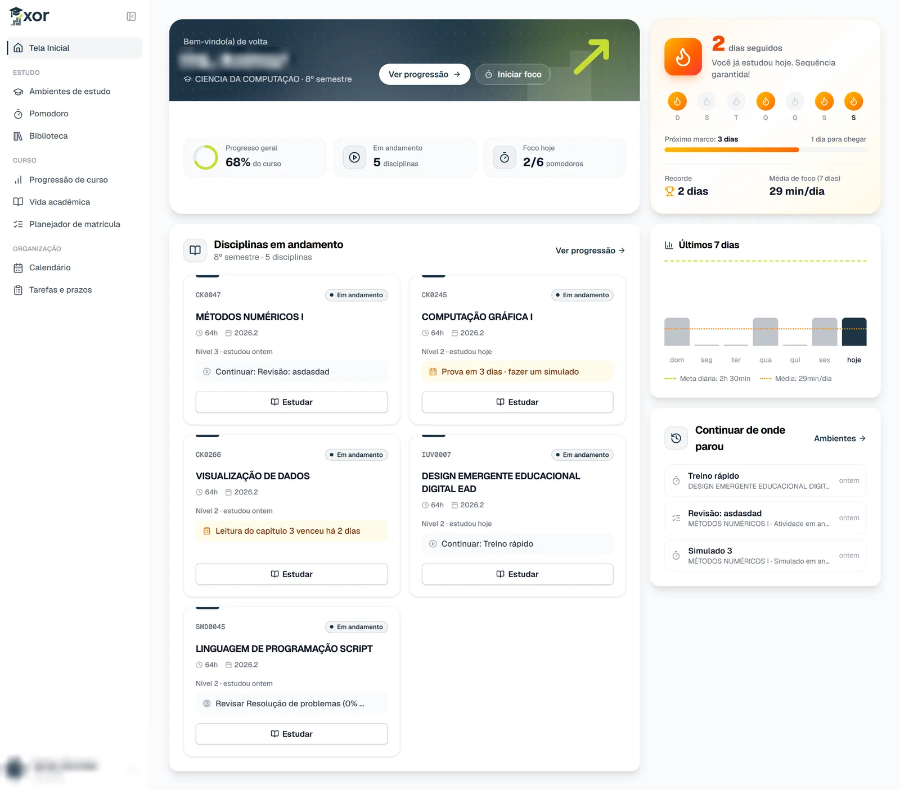

## O que dá pra fazer

### Curso

- Importar o histórico do SIGAA em PDF no cadastro. O arquivo é lido no navegador e não sobe para o servidor; dá pra completar ou corrigir à mão.
- Ver a progressão do curso: o que já foi concluído, o que está em andamento, o que falta e quanto de optativa ainda precisa.
- Acompanhar a vida acadêmica: IRA, evolução da média por período, desempenho e pré-requisitos.
- Montar o próximo semestre no planejador de matrícula, arrastando disciplinas para uma grade semanal que respeita pré-requisitos e carga mínima e máxima.
- Encerrar o semestre lançando as notas, o que já abre as disciplinas do próximo.

<table>
  <tr>
    <td>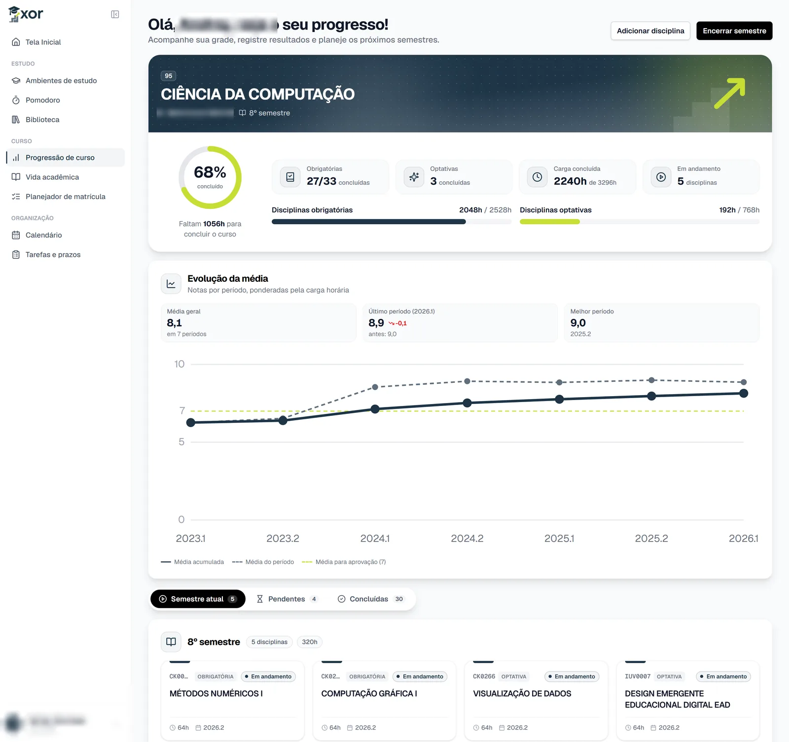</td>
    <td>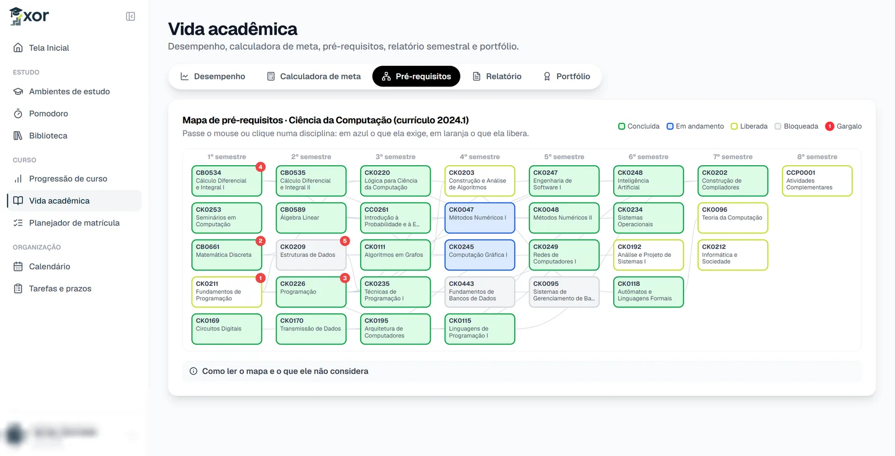</td>
  </tr>
</table>

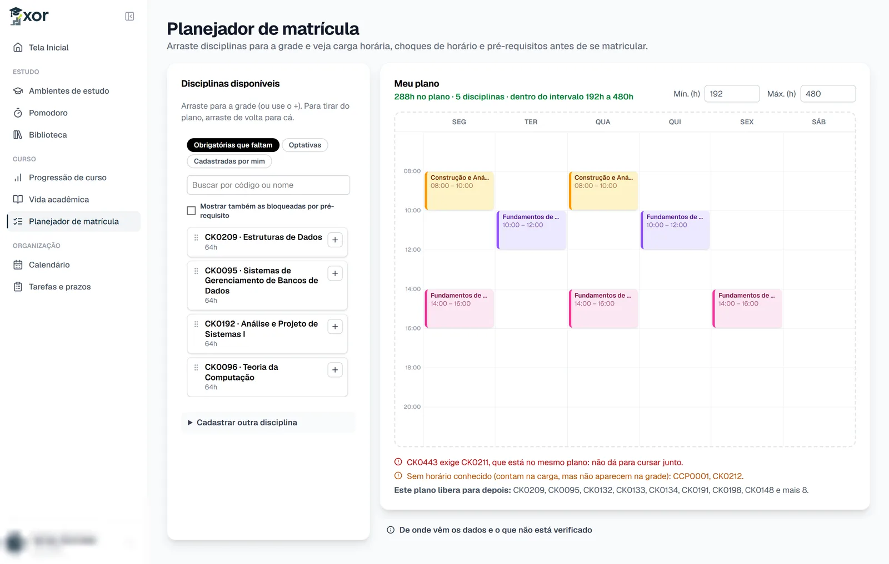

### Estudo

- Ambientes de estudo por cadeira, onde o aluno sobe slides, PDFs, DOCX e PPTX.
- Chat com a IA em cima desse material, com citação da fonte.
- Modo tutor: em vez de entregar a resposta do exercício, a IA faz perguntas e dá dicas aos poucos.
- Atividades geradas a partir do material (quiz, verdadeiro ou falso, lacunas, flashcards e discursivas). As discursivas são corrigidas por rubrica, com feedback.
- Resumos em tópicos, texto corrido, glossário ou mapa mental.
- Simulados com cronômetro.
- XP, nível, missões, conquistas e sequência de dias estudados. O XP é concedido no servidor e não premia repetir a mesma ação.
- Pomodoro com estatísticas de foco por disciplina.
- Biblioteca com playlists de aulas e livros abertos.

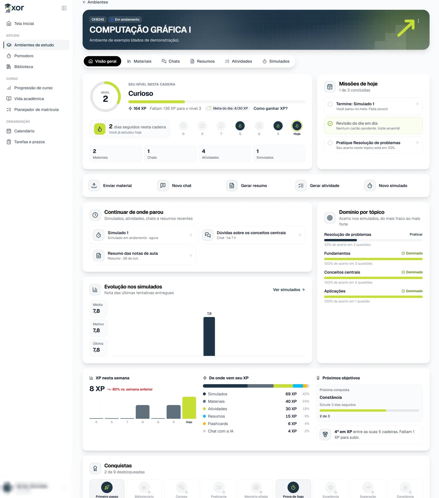

<table>
  <tr>
    <td>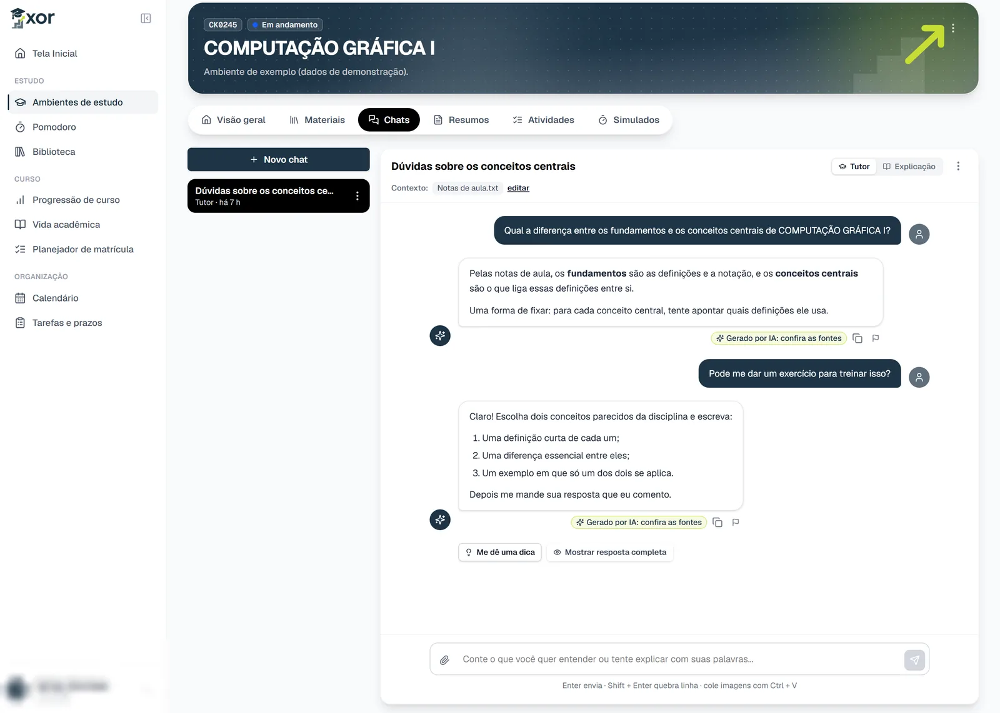</td>
    <td>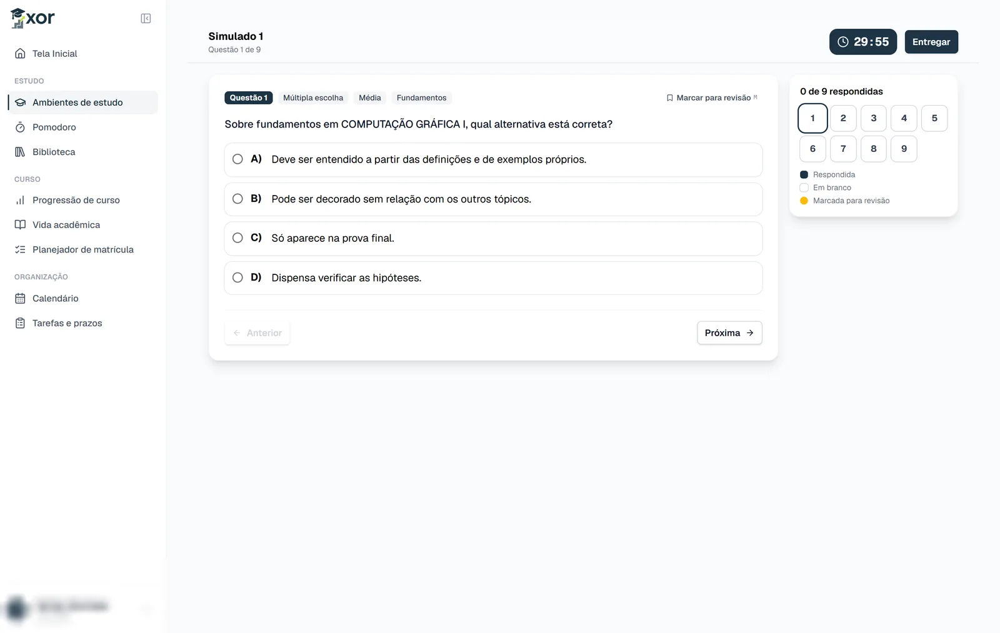</td>
  </tr>
</table>

<table>
  <tr>
    <td>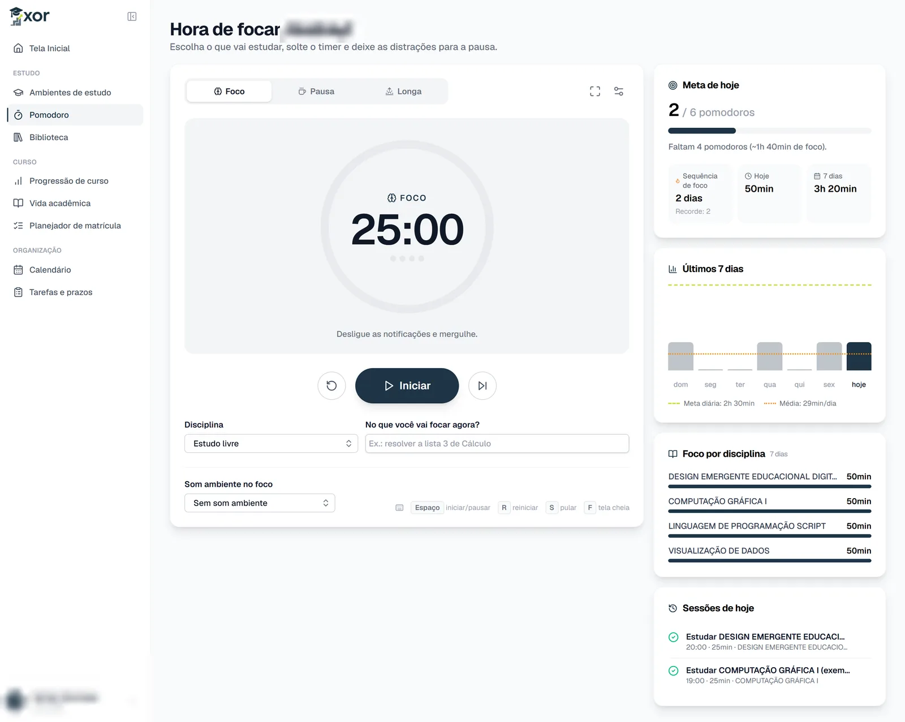</td>
    <td>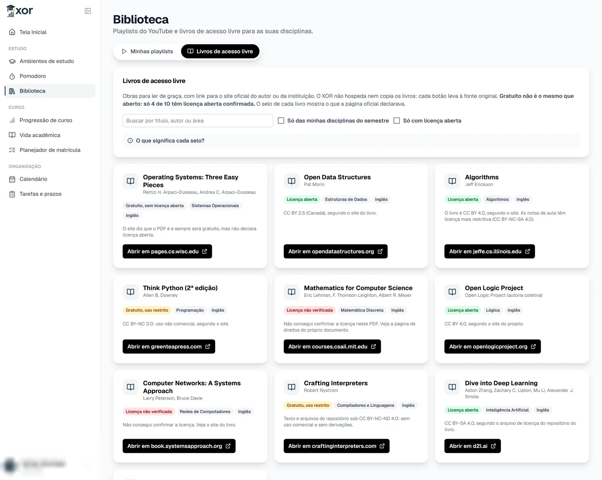</td>
  </tr>
</table>

### Organização

- Calendário com horários das disciplinas e provas.
- Tarefas e prazos.

<table>
  <tr>
    <td>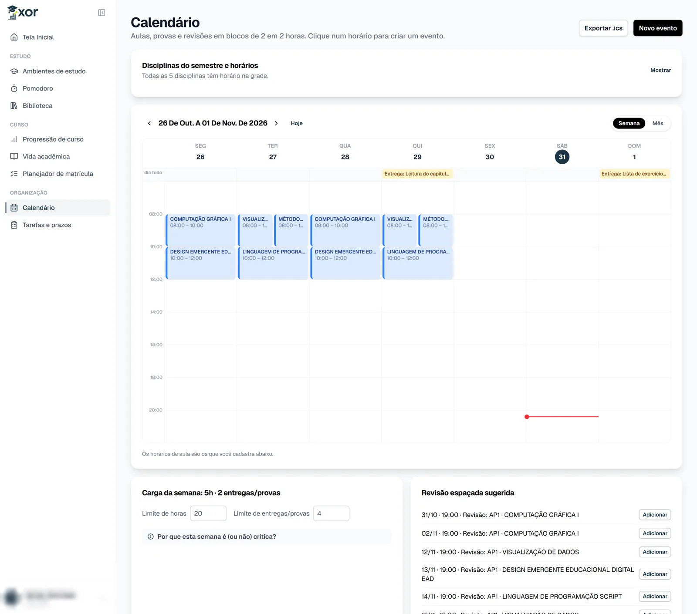</td>
    <td>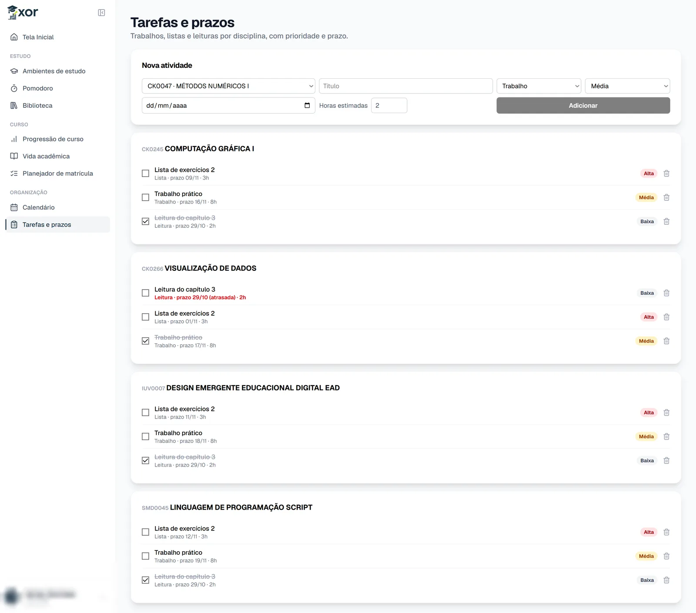</td>
  </tr>
</table>

## Sobre a IA

A IA roda com modelos abertos pelo Ollama, na máquina do aluno ou num servidor da própria universidade. O material não vai para serviços de IA externos. Todo conteúdo gerado aparece marcado como gerado por IA, pode ser reportado como errado ou sem fonte, e o prompt manda ignorar instruções escondidas dentro dos documentos. Na aba de privacidade do perfil, o aluno vê e apaga os próprios dados.

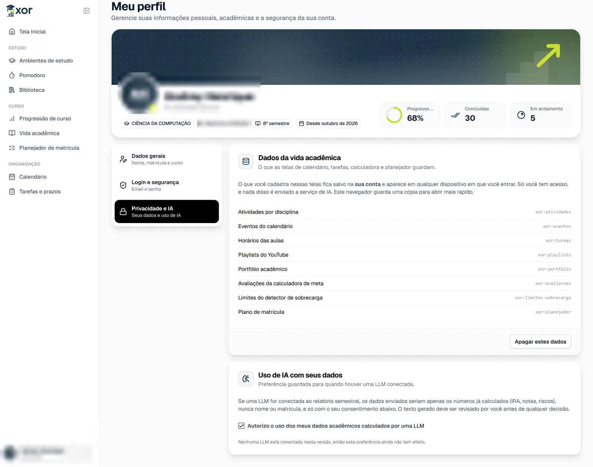

## Arquitetura

É um app Next.js só, fazendo front e back. As telas falam com as rotas em `/api`, e as rotas falam com o Supabase usando a sessão do próprio aluno, então quem decide o que cada um pode ler ou escrever é o RLS do Postgres.

```text
tela → hook do React Query → service (axios) → middleware → /api/... → lib/api → Supabase (RLS)
                                                                          └─→ Ollama (IA local)
```

- Front: Next.js 15 (App Router), React 19, TypeScript, Tailwind 4, React Query, react-hook-form e zod.
- Back: rotas de API do Next, validação com zod, sessão em cookie httpOnly via `@supabase/ssr` e checagem de origem contra CSRF no middleware.
- Banco: Postgres do Supabase, com RLS em todas as tabelas, pgvector para a busca semântica e Storage privado para os materiais.
- IA: Ollama com API compatível com a da OpenAI. O `xor-estudo` (Qwen3 4B) faz chat, resumos, questões e correção, e o `nomic-embed-text-v2-moe` gera os embeddings. A busca nos materiais é híbrida: por significado e por palavra-chave.
- PDF: `pdfjs-dist` para ler o histórico no navegador e para o leitor de PDF; `mammoth` e `jszip` para DOCX e PPTX.

Os detalhes estão em [docs/](docs):

- [arquitetura.md](docs/arquitetura.md): camadas, autenticação, cadastro e convenções
- [banco-de-dados.md](docs/banco-de-dados.md): tabelas, RLS e funções
- [api.md](docs/api.md): rotas

```text
src/
├── app/
│   ├── (public)/      login e cadastro
│   ├── (private)/     telas logadas
│   └── api/           rotas do back
├── components/        componentes compartilhados
├── hooks/             queries, mutations e chaves do React Query
├── services/          chamadas axios para /api
├── lib/api/           regras do back, schemas e IA
├── lib/supabase/      clientes do Supabase
├── utils/             leitor do histórico do SIGAA
└── middleware.ts      sessão, rotas protegidas e CSRF
supabase/migrations/   schema do banco
supabase/exemplos/     dados de exemplo para testar
ia/                    Modelfile do modelo local
```

## Rodando localmente

Precisa de Node 22.13+ (tem `.nvmrc`), um projeto no Supabase e, para a parte de IA, o [Ollama](https://ollama.com).

```bash
npm install
cp .env.example .env.local   # preencha as chaves do Supabase
npm run ia:setup             # baixa e testa os modelos da IA
npm run dev
```

As migrações de [supabase/migrations](supabase/migrations) precisam ser aplicadas em ordem, com `supabase db push` ou colando no SQL Editor. Para ter dados de teste, rode [supabase/exemplos/popular_exemplo.sql](supabase/exemplos/popular_exemplo.sql).

O app sobe em `http://localhost:3000`.

### Variáveis de ambiente

| Variável | Para quê |
| --- | --- |
| `NEXT_PUBLIC_SUPABASE_URL` | URL do projeto Supabase |
| `NEXT_PUBLIC_SUPABASE_PUBLISHABLE_KEY` | Chave publicável, usada com a sessão do aluno |
| `SUPABASE_SECRET_KEY` | Chave secreta, só no servidor (cadastro, troca de email e XP) |
| `NEXT_PUBLIC_SITE_URL` | Links absolutos do Open Graph. Padrão: `http://localhost:3000` |
| `LM_STUDIO_URL` | Endereço da IA. Padrão do Ollama: `http://localhost:11434/v1` |
| `LM_STUDIO_MODEL` | Modelo de texto, normalmente `xor-estudo` |
| `EMBEDDING_MODEL` | Modelo de embeddings. Padrão: `nomic-embed-text-v2-moe` |

A chave secreta ignora o RLS: nunca coloque o prefixo `NEXT_PUBLIC_` nela. Sem `LM_STUDIO_URL`, as rotas de IA respondem 503; sem o modelo de embeddings, a busca usa só palavras-chave.

### IA local

`npm run ia:setup` baixa os modelos na primeira vez, cria o `xor-estudo` a partir de [ia/xor-estudo.Modelfile](ia/xor-estudo.Modelfile) e testa chat e embeddings. `npm run ia:verificar` só confere se está tudo respondendo.

- Sem GPU ou com pouca memória: `npm run ia:setup -- --leve` usa o `qwen2.5:1.5b`.
- GPU com 8 GB ou mais: `npm run ia:setup -- --modelo=qwen3:8b`.
- Sem instalar o Ollama: `docker compose -f docker-compose.ia.yml up -d`.
- Uma máquina servindo a equipe: rode o Ollama nela com `OLLAMA_HOST=0.0.0.0 ollama serve` e aponte o `LM_STUDIO_URL` das outras para `http://<ip>:11434/v1`.

O LM Studio também funciona (`http://localhost:1234/v1`), carregando os modelos à mão.

## Scripts

| Comando | O que faz |
| --- | --- |
| `npm run dev` | Servidor de desenvolvimento |
| `npm run build` / `npm run start` | Build e servidor de produção |
| `npm run lint` | ESLint |
| `npm run tsc` | Checagem de tipos |
| `npm run ia:setup` | Prepara a IA local |
| `npm run ia:verificar` | Confere a IA local sem baixar nada |

O hook [.husky/pre-push](.husky/pre-push) roda `tsc`, `lint` e `build` antes do push. Ele só fica ativo depois de rodar `npx husky` uma vez.

## Convenções

Código, nomes e mensagens em português. Commits no padrão [Conventional Commits](https://www.conventionalcommits.org/pt-br/), como `feat(ambiente): ...` ou `fix(auth): ...`. Prettier sem ponto e vírgula e com aspas simples.
